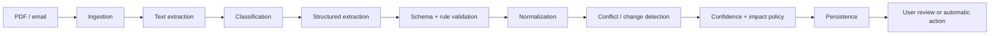

# AI Pipeline



Each stage records a version and safe diagnostic status. Evidence offsets/excerpts and source identity travel with every candidate. Normalization must preserve original text, timezone, and ambiguity; it must not turn missing fields into facts.

## Hallucination prevention

- Ask only for schema-constrained fields with explicit unknown/null states.
- Require evidence for each material field and verify evidence exists in extracted content.
- Validate types, dates, applicability, recurrence, and cross-field consistency deterministically.
- Treat confidence as a policy input, not proof; missing/contradictory evidence routes to review.
- Never use model output alone to establish source authority or auto-apply high-impact changes.
- Version prompts/models and evaluate before promotion; preserve human corrections without training on them by default.

## Prompt injection and hostile content

Documents/emails are untrusted data, never instructions. Delimit content, tell models to ignore embedded directives, restrict tool access, and keep extraction calls incapable of sending messages or mutating calendars. Scan files, cap resources, sanitize active content, validate all outputs, and detect/escalate suspicious instruction-like text. Provider responses cannot bypass authorization or policy.

Automatic-action thresholds, model/provider, OCR, language coverage, and review policy are **TBD**.

## Current backend extraction path

The first real local processor handles text-based PDFs only:

```text
uploaded PDF bytes
-> page-aware text extraction
-> deterministic text normalization
-> OpenAI Responses API structured extraction
-> deterministic semantic validation
-> ExtractionResultDTO-compatible response
```

OCR is not implemented. A scanned/image-only PDF fails with a typed no-extractable-text/OCR-required processing failure rather than being treated as a generic AI failure.

OpenAI calls use JSON Schema Structured Outputs and no tools. PDF text is explicitly passed as untrusted source data, not instructions. The backend validates model evidence against extracted page text before accepting a candidate. Invalid candidates are dropped when valid siblings remain; if no AI candidate passes validation, processing fails with a semantic-validation category.

The implemented version constants are:

- `EXTRACTION_SCHEMA_VERSION`
- `PROMPT_VERSION`
- `EXTRACTION_ENGINE_VERSION`

These are recorded with file/content hashes and token usage as internal processing metadata. They will participate in future cache and deduplication identity, but this implementation does not skip AI calls or perform cross-account reuse.

## Deduplication and privacy-safe reuse

The backend owns authoritative deduplication. It compares SHA-256 of original file bytes for exact duplicates, then a normalized extracted-content hash for equivalent content whose bytes differ. Future document-version diffing or incremental processing is **TBD**. Mobile does not decide that two documents or extractions are equivalent; any future client hash is an untrusted optimization hint that the server verifies.

An extraction cache identity includes at least:

```text
content hash + extraction schema version + prompt version + extraction engine/model version
```

Provider and prompt details remain backend metadata; mobile receives only the extraction schema version needed to interpret its contract.

Hash equality never authorizes cross-account access or reuse. Tenant/account isolation is the default. Reuse requires compatible scope, verified source/context, authorization, and an explicit privacy policy:

- Public school calendars and verified school-, year-, or class-wide official documents may be eligible for controlled reuse.
- Child-specific documents, private parent communications, personalized reports, and identifiable correspondence are never cross-account reusable by default.
- If safe reuse cannot be proven, processing and results remain within the current account boundary.

Even when computation is reused, the requesting account receives only a newly authorized document/result association; it never receives another household's source record, private context, or review history.

Extraction Review never re-runs AI. Confidence is advisory; evidence stays visible, and high-impact/conflicting candidates require explicit human decisions under the proposed review policy.

After confirmation, deterministic mapping—not AI—creates calendar-domain proposals. Missing temporal structure is skipped rather than inferred, and no EventKit or persistence side effect occurs.
