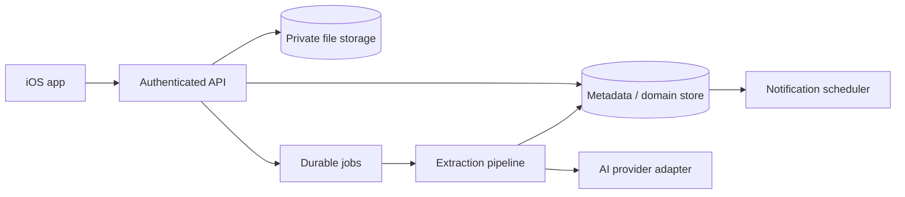

# Backend Architecture

The backend owns authentication enforcement, ingestion, file access, AI-provider calls, validation, conflict/change detection, persistence, audit history, and notification scheduling. Mobile holds no AI-provider secret and cannot mark unvalidated provider output as trusted.

AI providers sit behind an adapter so provider-specific requests and responses do not become domain contracts. Durable jobs are idempotent, retryable, versioned, observable, and account-scoped. Raw files live in private storage with short-lived authorized access.

Supabase for authentication, PostgreSQL, and storage is **Proposed**, not final. Job execution, email connection, push delivery, AI provider, hosting region, and notification scheduling are **TBD**. Selection must satisfy [SECURITY.md](../security/SECURITY.md) and [DATA_RETENTION.md](../security/DATA_RETENTION.md).

## Initial local backend foundation

The repository contains a development backend under `backend/` using Node.js, TypeScript, and Fastify. This is an accepted foundation for exercising the iOS document lifecycle contract locally, not a production deployment architecture.

The current implementation includes `GET /health`, `POST /v1/documents`, `GET /v1/documents/:id/status`, and `GET /v1/documents/:id/extraction`.

Documents are stored behind a focused `DocumentStore` abstraction with an `InMemoryDocumentStore` implementation. This store is development-only infrastructure: it is process-local, non-durable, and intended to be replaced by account-scoped durable metadata and private file storage.

Processing is handled through a `DocumentProcessor` abstraction. `FakeDocumentProcessor` remains available for deterministic local/testing extraction. `OpenAIDocumentProcessor` is the first real processing path for text-based PDFs: it loads the bounded in-memory upload, extracts page-aware text, normalizes text, calls the backend-owned OpenAI extraction client, validates structured output deterministically, and persists an `ExtractionResultDTO`-compatible result.

The local store retains uploaded PDF bytes in memory only for development and only within the configured `MAX_UPLOAD_BYTES` limit. It also records internal file/content hashes and processing metadata, including schema/prompt/engine versions and token usage when the provider returns it. These fields are not exposed to iOS.

The real processor uses typed failure categories for invalid PDFs, no extractable text/OCR-required cases, PDF extraction failure, OpenAI provider/rate-limit/invalid-response cases, semantic validation failure, and generic processing failure. The iOS status contract remains stable and exposes only `failed`; extraction requests receive safe error envelopes without provider bodies or stack traces.

Production work remains TBD for authentication and authorization, malware/file scanning, durable job execution, private file storage, observability, retention enforcement, OCR, and deployment hardening.
