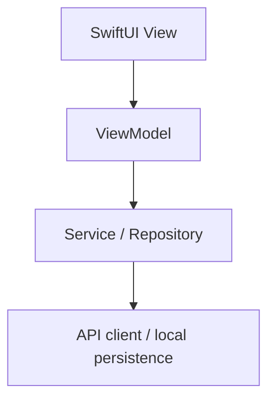

# iOS Architecture

ParentPilot uses **SwiftUI + MVVM** as its primary iOS application architecture. It is feature-oriented and intentionally pragmatic: use cases and repositories are available when they solve real complexity, but they are not mandatory layers.

## Default dependency flow



- A SwiftUI `View` declares the interface, renders state, and forwards user intent. It contains minimal business logic.
- A `ViewModel` owns presentation state and coordinates user actions. ViewModels do not perform raw networking or persistence directly.
- A service encapsulates an external or application operation such as authentication, document upload, calendar access, or notifications.
- A repository is introduced only when meaningful persistence, caching, synchronization, or multiple-data-source complexity warrants that abstraction.
- API clients and persistence implementations own transport/storage details and map DTOs before values reach feature code.

Swift Concurrency is the default asynchronous mechanism. UI-updating ViewModels run on `@MainActor`; use Observation (`@Observable`) where supported and appropriate. Do not introduce Combine without a concrete requirement.

## Feature-oriented structure

The target conceptual structure is:

```text
ParentPilot/
├── App/
│   ├── ParentPilotApp.swift
│   ├── AppRouter.swift
│   └── AppDependencies.swift
├── Core/
│   ├── Networking/
│   ├── DesignSystem/
│   ├── Persistence/
│   ├── Extensions/
│   └── Utilities/
├── Models/
├── Services/
└── Features/
    ├── Authentication/
    ├── Home/
    ├── Documents/
    ├── ExtractionReview/
    ├── Calendar/
    └── Settings/
```

Each user-facing feature normally contains a View and ViewModel. Feature-specific components and models stay inside that feature until genuine reuse justifies moving them. For example:

```text
Features/
└── Documents/
    ├── DocumentsView.swift
    ├── DocumentsViewModel.swift
    └── Components/
```

The ordinary Documents dependency path is:

```text
DocumentsView
↓
DocumentsViewModel
↓
DocumentService
↓
RemoteDocumentService
↓
APIClient
```

## Optional use cases and repositories

A use case is appropriate when business logic is complex, reusable across features, coordinates multiple services/repositories, or deserves isolated testing. In that case, the allowed flow is:

```text
View → ViewModel → Use Case → Services / Repositories
```

This is the exception, not the default. Do not create a use case for each ViewModel action or require a repository between every service and data source. Use cases and repositories are tools for meaningful boundaries, not compliance layers.

## Dependencies and boundaries

`AppDependencies` is the composition root for constructing concrete services and injecting them into features. Prefer protocol-based dependency injection when substitution provides a real test, platform, or implementation benefit; a concrete type is acceptable when no such boundary exists.

DTOs remain separate from app/domain models. Networking and persistence code performs mapping and translates infrastructure errors before returning values to ViewModels or use cases.

Navigation remains separate from ViewModels where practical. Routes and presentation coordination belong to `AppRouter` or a feature navigation owner; ViewModels may expose navigation intent without owning `NavigationStack`. Shared state must have explicit ownership and lifecycle, never an unbounded global mutable singleton.

## Avoiding ceremonial architecture

Do not introduce `BaseViewModel`, `BaseRepository`, `BaseService`, or similar inheritance hierarchies. Avoid generic abstractions, pass-through layers, and speculative shared modules. Add a boundary only when it clarifies ownership, isolates a volatile dependency, centralizes meaningful policy, or measurably improves testing.

AI and source processing remain backend responsibilities. The app presents lifecycle state and reviewed domain results, never provider prompts or secrets. See [API_CONTRACT.md](../backend/API_CONTRACT.md) and [STATE_MANAGEMENT.md](STATE_MANAGEMENT.md).

## Document-ingestion foundation

`RemoteDocumentService` is the concrete service boundary for upload, processing status, and extraction retrieval. It depends directly on `APIClient`, maps document DTOs into domain models, and translates infrastructure failures into `DocumentServiceError`. No repository or use case is justified for this single remote source. Multipart encoding and lightweight PDF validation live outside the service so request construction and file checks remain focused and testable.

The first feature follows `DocumentsView → DocumentsViewModel → DocumentService → APIClient`. `DocumentsView` owns `fileImporter`; the ViewModel receives selection intent, owns presentation state, and never performs raw API calls. `TemporaryDocumentImporter` isolates security-scoped access and temporary copying. `DocumentProcessingMonitor` isolates bounded polling so another status-delivery mechanism can replace it without changing feature state.

Extraction Review is a local MVVM feature: its ViewModel receives the completed result, applies an isolated review policy, and retains the confirmed selection. It performs no networking or persistence. Documents presents it directly as a sheet so extraction payloads do not enter navigation routes.

`ReviewedExtractionMapper` is a deterministic, nonisolated conversion service from confirmed review output to calendar-domain events, tasks, reminder intents, overrides, and typed skips. It performs no I/O, EventKit access, or persistence.

## Calendar persistence foundation

`CalendarStore` is the persistence boundary for actionable ParentPilot calendar-domain models. Callers pass and receive `SchoolEvent`, `SchoolTask`, `ReminderIntent`, and `ScheduleOverride`; persistence entities and framework types remain behind concrete adapters. No repository wraps this boundary.

`InMemoryCalendarStore` is the current development, preview, and test implementation. It is an actor-owned, non-durable store composed in `AppDependencies`; it is not global and is not injected into a feature ViewModel yet. A save of one `CalendarMappingResult` validates and commits all actionable arrays atomically. Skipped mapping candidates remain diagnostics in the mapping/commit result and are not calendar records.

`ReviewedCalendarCommitService` owns the meaningful application operation `ExtractionReviewResult → ReviewedExtractionMapper → CalendarStore`. It returns stable persisted identities and mapping skips. The service is intentionally not wired to Extraction Review UI in this foundation task.

A future `SwiftDataCalendarStore` may implement the same protocol through an explicit `Domain ↔ Persistence Entities ↔ SwiftData` mapping boundary. Domain models and callers must not acquire SwiftData annotations or types.
